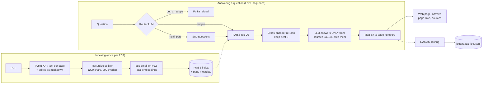

# Filings Analyst: single-source RAG over an annual report

Ask plain-English questions about a company's annual report and get answers grounded in the
document, with **every claim cited to the PDF page it came from**. Each answer is also scored
with **RAGAS** and logged.

**Domain:** #4 Financial Filings Analyst. **Document:** HCLTech Integrated Annual Report 2025–26 (455 pages).

**Live demo:** `https://<your-space>.hf.space` · **API docs:** `https://<your-space>.hf.space/docs`

---

## What it does

| Brief requirement | How this project meets it |
|---|---|
| PDF upload → chunking → local embeddings → FAISS → LCEL chain → LLM | `ingest.py` → `index.py` → `answer.py`; upload via the web page or `POST /documents` |
| Re-ranking before generation | FAISS top-20 → local cross-encoder (`jina-reranker-v1-turbo-en`) → best 8 (`rerank.py`) |
| Routing / decomposition | An LLM router classifies each question as `simple`, `multi_part` or `out_of_scope`; multi-part questions are split and retrieved separately (`router.py`) |
| RAGAS per query | Faithfulness, answer relevancy, context precision → `logs/ragas_log.jsonl` (`evaluate.py`) |
| Source attribution | The LLM cites `[S1]…[S8]`; code maps each tag to the chunk's page from metadata. The LLM never writes page numbers itself |
| Before/after re-ranking evidence | Golden-set evaluation with Hit@k and MRR (`eval_retrieval.py`, results below) |

## Architecture



## Tech stack

| Layer | Choice | Why |
|---|---|---|
| API + web server | FastAPI | Simple, async, auto-generated API docs at `/docs` |
| Front end | One HTML page (vanilla JS) | No build step; served by FastAPI, so one URL |
| Orchestration | LangChain 0.3 (LCEL) | Composable chain: router → retrieve → re-rank → generate |
| PDF parsing | PyMuPDF | Fast text extraction with page numbers, built-in table detection |
| Embeddings | `BAAI/bge-small-en-v1.5` via FastEmbed (ONNX) | Strong small model; runs locally with no PyTorch |
| Vector store | FAISS | Local, fast, saved to disk |
| Re-ranker | `jinaai/jina-reranker-v1-turbo-en` via FastEmbed | Local cross-encoder; beat MS MARCO MiniLM on this data (see below) |
| LLM | `google/gemini-2.5-flash` via OpenRouter (configurable) | Any provider can be swapped in with `.env` |
| Evaluation | RAGAS 0.2.15 | Faithfulness, answer relevancy, context precision |
| Hosting | Hugging Face Spaces (Docker) | Free tier with enough RAM for local models |

## Project structure

```
ingest.py          PDF -> page-tagged text and table chunks
index.py           local embeddings + FAISS (built once, saved to data/index)
rerank.py          cross-encoder re-ranking of FAISS candidates
router.py          simple / multi_part / out_of_scope classification + decomposition
llm.py             one place to configure the LLM provider and model
answer.py          the LCEL chain + citation mapping; also a terminal Q&A loop
evaluate.py        RAGAS scoring + JSONL logging
api.py             FastAPI app (upload with progress, query, evaluate)
static/index.html  the web page
eval_retrieval.py  golden-set Hit@k / MRR: FAISS vs re-ranked
find_pages.py      helper: find every page containing an answer value
golden_set.json    evaluation questions with answer-bearing pages
data/index/        pre-built FAISS index for the HCLTech report
logs/              RAGAS per-query log
```

## Setup (run it on your own machine)

**Prerequisites:** Python 3.11, an [OpenRouter](https://openrouter.ai) API key (or a Google Gemini key).

```bash
git clone https://github.com/venkiit/fin_rag.git
cd fin_rag
python3 -m venv .venv
source .venv/bin/activate              # Windows: .venv\Scripts\Activate.ps1
python -m pip install -r requirements.txt
cp .env.example .env                   # then put your key in .env
```

`.env`:
```
LLM_PROVIDER=openrouter
LLM_MODEL=google/gemini-2.5-flash
OPENROUTER_API_KEY=sk-or-...
```

Download the report into `reports/`. PDFs are not committed because of their size:
`reports/hcl_2026.pdf`, the HCLTech Integrated Annual Report 2025–26, from HCLTech's investor relations site.

Run the web app:
```bash
python -m uvicorn api:app --port 8000
```
Open http://localhost:8000. The first start downloads the two local models (~220 MB).

Terminal versions of each stage:
```bash
python answer.py reports/hcl_2026.pdf          # ask questions, see route, answer, sources, RAGAS
python rerank.py reports/hcl_2026.pdf          # see FAISS rank vs re-ranked rank per chunk
python eval_retrieval.py reports/hcl_2026.pdf  # golden-set Hit@k / MRR
```

**macOS notes:** on macOS older than 13.4, use `onnxruntime==1.19.2` (pinned in requirements). FAISS
and ONNX Runtime both ship OpenMP; the code sets `OMP_NUM_THREADS=1` and runs the re-ranker
single-threaded in the main thread to avoid a deadlock seen inside LangChain worker threads.

## API reference

Interactive docs: `/docs`.

| Method | Path | Description |
|---|---|---|
| `GET` | `/` | Web page |
| `GET` | `/health` | Status and number of loaded documents |
| `GET` | `/documents` | List documents and their indexing status |
| `POST` | `/documents` | Upload a PDF (multipart field `file`). Returns `doc_id` immediately; indexing continues in the background |
| `GET` | `/documents/{doc_id}/status` | Indexing progress: `stage` (`reading` / `embedding` / `ready`), `done`, `total` |
| `GET` | `/documents/{doc_id}/pdf` | The PDF, so citations can open `#page=N` |
| `POST` | `/query` | `{"doc_id": "hcl_2026", "question": "..."}` → answer, route, sub-questions, citations, retrieved pages, `query_id` |
| `POST` | `/evaluate/{query_id}` | Runs RAGAS for that answer, appends it to the log, returns the scores |
| `GET` | `/evaluations` | Recent RAGAS log entries |

Example `POST /query` response:
```json
{
  "query_id": "3f2a9c1b7d",
  "route": "multi_part",
  "sub_questions": ["What was the total revenue?", "How many employees does HCLTech have?"],
  "answer": "**Total Revenue**\nThe consolidated total revenue ... was ₹130,144 Crores [S1]. ...",
  "citations": [{"tag": "S1", "page": 116, "type": "text", "snippet": "Segment wise breakup of Revenue ..."}],
  "retrieved": [{"rank": 1, "page": 116, "chunk_id": "p116-t0"}],
  "pdf_url": "/documents/hcl_2026/pdf",
  "can_evaluate": true
}
```

## Evaluation

### 1. Does re-ranking improve result order? (golden set)

`golden_set.json` has 6 questions with verified answers. A page counts as **relevant if any of its
chunks contains the verified answer value** (found by exact string search with `find_pages.py`), an
objective and reproducible rule. Run `python eval_retrieval.py reports/hcl_2026.pdf`.

| Metric | FAISS only | FAISS + re-ranker | Change |
|---|---|---|---|
| Hit@1 | 0.33 | 0.33 | +0.00 |
| Hit@3 | 0.50 | 0.50 | +0.00 |
| Hit@5 | 0.67 | 0.83 | **+0.17** |
| Hit@8 | 0.67 | 0.83 | **+0.17** |
| MRR | 0.47 | 0.49 | +0.02 |

| Question | FAISS rank | Re-ranked rank |
|---|---|---|
| What was the total revenue for the year? | 1 | 1 |
| How many employees does HCLTech have? | 1 | 1 |
| What was the total dividend paid for the year? | 4 | 4 |
| What is the employee attrition rate? | **19** | **2** |
| What was the net profit for the year? | 2 | 5 |
| What was the EBIT margin for the year? | not in top 20 | not in top 20 |

**Reading:** re-ranking's main win is rescuing answers buried deep in the FAISS list (attrition:
rank 19 → 2), which lifts Hit@8, the share of questions where a correct page reaches the LLM, from
0.67 to 0.83. It is not uniformly better: net profit dropped from 2 to 5, though it stayed within
the 8 chunks sent to the LLM. The sample is small (6 questions).

### 2. Experiments behind the design choices

- **Re-ranker model.** `ms-marco-MiniLM-L-6-v2`, trained on web passages, pushed the consolidated
  income statement (p.375, the authoritative revenue answer) from rank 5 to rank 8, out of the
  top 5. It preferred fluent prose over flattened financial tables. `jina-reranker-v1-turbo-en`
  kept it in the top 5, so we use Jina.
- **How many candidates to re-rank.** Re-ranking FAISS top-50 instead of top-20 raised MRR
  (0.47 → 0.54) but lowered Hit@8 (0.83 → 0.67): extra distractors pushed correct answers out of
  the 8 chunks given to the LLM. We chose top-20.

### 3. RAGAS (per query, `logs/ragas_log.jsonl`)

Each answer is scored for faithfulness, answer relevancy and context precision (the reference-free
variant, since live questions have no ground truth). Examples:

| Question | Route | Faithfulness | Answer relevancy | Context precision |
|---|---|---|---|---|
| What was the total revenue for the year? | simple | 1.00 | 0.79 | 0.81 |
| What was the total revenue and how many employees does HCLTech have? | multi_part | 1.00 | 0.69 | 0.00 |

**Reading the scores:**
- **Faithfulness is not correctness.** The multi-part answer reported 237,098 employees from the
  BRSR section (p.216), while the highlights page reports a 227,181 people count. The answer is
  fully supported by its source (faithfulness 1.0) but uses a different definition of headcount.
- **Context precision struggles with multi-part answers.** Each chunk supports only one half of the
  answer, and the judge rated each chunk against the whole answer, giving 0.0.

## Design decisions

- **Citations come from metadata, not the LLM.** Chunks are numbered `[S1]..[S8]`; page numbers are
  attached in code, so every cited page really contains the cited chunk.
- **Recursive splitting rather than semantic chunking.** Annual reports are already structured into
  short paragraphs, so paragraph-aware splitting follows topic boundaries. Semantic chunking would
  embed every sentence (minutes of extra indexing) for little expected gain, and handles tables poorly.
- **Tables as separate chunks.** Detected tables are stored whole as markdown so rows keep their
  headers; false detections (e.g. charts) with fewer than 3 rows or 2 columns are discarded.
- **Standalone vs consolidated.** Indian annual reports contain both. The prompt tells the LLM to
  prefer consolidated (group) figures and say which it is quoting.
- **Local embeddings and re-ranking via ONNX (FastEmbed).** Meets the brief's "local embeddings"
  requirement without installing PyTorch.
- **Indexing progress without threads.** Uploaded PDFs are indexed on the server's event loop,
  yielding after every page and embedding batch, so the progress bar can poll while it runs.

## Known limitations

- Text and numbers inside images or charts (e.g. infographic highlights pages) are not read; no OCR.
- Borderless financial tables are often not detected as tables and arrive as flattened text.
- Units such as "₹ in crores" sit in table headers and can end up in a different chunk from the numbers.
- The golden set is small (6 questions); "relevant page" is defined by exact answer-value match.
- Uploaded documents are stored on local disk; on a free hosted Space they reset when it restarts.
  The Ashok Leyland Annual Reports 2026 index is pre-built and always available.
